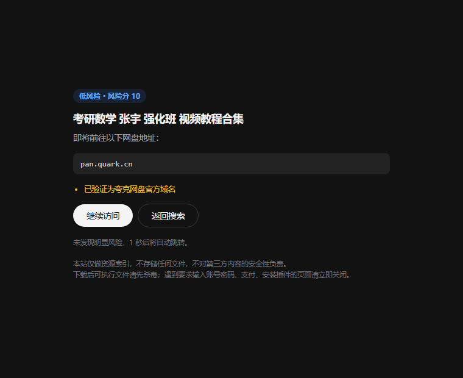
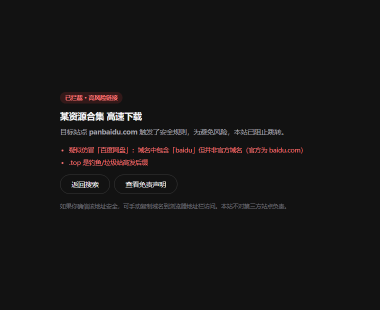

# ZSEARCH · 网盘资源搜索引擎

对 `zreso.cn` 的前端高保真复刻 + **三源聚合**网盘搜索。**Node / Express** 技术栈。

---

## 快速开始

**双击 `启动.bat`**（或 `start.bat`）—— 自动找 Node、装依赖、刷新资源版本号、清端口、开浏览器。

它带**自动重启**：上游风控把服务打挂（例如 zreso 429 触发熔断）时会自动拉起，退避 `3s → 6s → 12s → 24s → 30s` 封顶。按 `Ctrl+C` 或关闭窗口即彻底停止（不会重启）；端口被占用属配置问题，会明确报错后停下而不是无限重试。

> `start.bat` 只是英文名转发入口，实际逻辑都在 `启动.bat` —— 改启动流程只改后者，避免两份逻辑漂移。

命令行方式：

```bash
cd E:\网盘\zsearch
npm install          # 已装好，重装才需要
npm start            # 或 node server.js
```

打开 http://localhost:5178

### 改了代码但界面没变？（缓存说明）

静态资源走**协商缓存**（`max-age=0` + ETag）：内容没变返回 304 省流量，变了立刻更新。HTML 则是完全禁缓存。

另外所有 CSS/JS 引用都带**内容哈希版本号**（`base.css?v=7dbc642b`），由 `_stamp.js` 自动维护，`启动.bat` 每次启动会先跑一遍：

```bash
node _stamp.js          # 给所有 HTML 刷新版本号
node _stamp.js --check  # 只检查是否有过期版本号（非 0 退出码表示需刷新）
```

**所以正常情况下你不需要手动清缓存。** 如果换了界面但浏览器还是旧的（多见于改动之前就已缓存的页面），`Ctrl + F5` 强刷一次即可，之后都会自动保持最新。

---

## 三源聚合架构

这是本项目的核心：**同一个关键词，并发问三个机制完全不同的数据源，合并去重后统一呈现。**

| 数据源 | 域名 | 机制 | 链接形态 | 特点 |
| --- | --- | --- | --- | --- |
| **盘搜** `pansou` | so.252035.xyz | `POST /api/search`，入参 `kw` | **真实直链** | 聚合上百个 TG 频道 + 数十个插件，字段最全（note / 来源频道 / 提取码），量最大；有 IP 短时限流 |
| **珈珈搜索** `jso` | j-so.com | `GET /s/<urlencode(kw)>?__full=1` + 请求头 `X-Search-Full: 1` | **真实直链** | 服务端渲染 HTML，直链内嵌在 `data-real-link` 属性；自带链接检测接口 |
| **原站** `zreso` | zreso.cn | `GET /api/search?q=&sort=&cloud=` | 中转链接 `/api/wash?t=` | 原站，返回中转链接需二次解析；有 Cloudflare Turnstile 风控，最易失效 |

三者机制互补，缺一不可：扣掉任何一个，覆盖的网盘类型和资源数量都会明显下降。

### 聚合流程

```
关键词
  │
  ├─→ [pansou] ─ 20s 超时 ─ 400/429 指数退避 ─ 5min 结果缓存
  ├─→ [jso]    ─  9s 超时 ─ HTML 解析失败即返回 [] ─ 5min 结果缓存
  └─→ [zreso]  ─  6s 超时 ─ 缓存/限速/熔断四层降级
  │
  ├─ 合并：按「域名+路径」归一化去重（同一条夸克链接的不同写法视为同一条）
  ├─ 择优：同一条链接多源命中时，按质量分保留更优的那条（真实直链 > 中转链接）
  │        并记录全部来源（_providers），前端显示「盘搜 + 珈珈」
  ├─ 排序：**相关性优先**（relevance×3）→ 新鲜度加成（sort=latest/oldest，0~12）→ 质量分
  │        刻意不以日期为主键：查「甄嬛传」时 2022 年的正片必须排在
  │        今天发的无关资源前面。日期只在同分时兜底。
  ├─ 过滤：类型 tab（quark/baidu/uc/xunlei；其余类型归 other，在「全部」里可见）
  └─ 输出：最多 300 条，带 source / providers / degraded 元信息
```

**关键设计：部分成功优于全失败。** 任一源挂掉都不影响其他源，前端会如实显示「N 源未响应」，但不装死、不全屏报错。

### 两阶段（渐进式）搜索

夸克资源几乎全部来自 pansou，而 pansou 的响应时间方差极大：实测同一个站
「三体」0.95s、「甄嬛传」4.97s、「考研」12s、偶尔直接吃满 20s 超时。如果只发
一次请求并等它，首屏会被最慢的那次拖死；如果给一个统一的短超时，又会在慢查询
上把夸克结果整批丢掉 —— 这正是「很多结果里没有夸克」的真正原因。

所以拆成两段，**并发发出、先进先显**：

```
浏览器                    服务端
  │ GET /api/search?fast=1  │ 只跑 6.5s 上限，先回来的源先返回
  ├────────────────────────>│   （pansou / hunhepan / zreso 全体参与）
  │   ← 阶段 1（通常 1~6s）  │
  │                         │
  │ GET /api/search         │ 全量：pansou 走它自己的 25s × 其他源
  ├────────────────────────>│
  │   ← 阶段 2             │
```

三条配套约束，缺一条这套就会退化成 bug：

1. **上游不重复打**：pansou 适配器里有 in-flight 去重（`lib/sources/pansou.js`）。
   阶段 2 遇到阶段 1 还在跑的同 key 请求，直接 `await` 那个 Promise，不新发一次。
   PanSou 按 IP 限流，打两次会双双 400。
2. **硬超时不记健康失败**：`Promise.race` 砍掉的请求仍在后台跑完并写缓存。
   若在超时处记一笔失败，第一阶段每次都砍在 6.5s，三次就能把唯一可用的 pansou
   送进 10 分钟冷却，全站瞬间「什么都搜不到」。
3. **结果不缩水**：上游抖动时同一个词两次调用可能返回 14 条 / 6 条。阶段 2 若比
   阶段 1 少，就把阶段 1 独有的条目补在后面（`mergeNoShrink`），绝不凭空消失。

### 结果字段

```json
{
  "title": "资源名", "date": "2026-09-14", "note": "补充描述",
  "cloud_type": "quark", "cloud_type_name": "夸克网盘",
  "status": "valid", "password": "提取码(可空)",
  "origin": "tg:xxx",           // PanSou 的频道来源
  "provider": "pansou",         // 主要来源
  "_providers": ["pansou","jso"], // 全部命中来源
  "target": "/go/xxxxxxxx"      // 点击走本站短链 → 302 直跳
}
```

---

## 目录结构

```
zsearch/
├─ server.js                 # Express 入口：路由、/go 安全把关与跳转、页面渲染、/__shutdown
├─ config.js                 # 所有开关集中在这里（含 security 段；改完重启）
├─ 启动.bat / start.bat       # 一键启动（纯 ASCII；start.bat 为转发别名）
├─ _stamp.js                 # 刷新静态资源内容哈希版本号（启动时自动跑）
├─ _qa.js                    # 后端质检（含条件断言，条数随上游是否返回结果浮动，满配 89）
├─ _qa_ui.js                 # 前端质检 37 条（真实浏览器 CDP）
├─ _qa_stress.js             # 压力与健壮性质检 72 条
├─ _qa_ui_static.js          # 界面代码静态审查 55 条（HTML/CSS 缺陷扫描）
├─ _qa_polish.js             # 质感层专项 35 条（聚光 / 数字滚动 / 懒渐入 / 关动效不隐藏）
├─ _qa_security.js           # 安全模块单元测试 51 条
├─ _qa_security_e2e.js       # /go 安全把关端到端 20 条
├─ _shot_wb.js               # 工作台出图 + 断言（收藏/历史/探活/CSV/状态）
├─ _shot_wall.js             # 壁纸与外观抽屉出图 + 断言
├─ _shot_polish.js           # 卡片聚光目视出图（亮/暗两张，验完即删）
├─ _verify_fade.js           # 壁纸切换运行时降级 26 条（不测时间，只测计算样式）
├─ _perf_wall.js             # 壁纸切换性能实测（帧间隔/掉帧/重算样式，带空闲基线）
├─ _verify.js                # 早期 25 条快速回归（可选）
├─ 品牌资源（改 logo 时按顺序跑）
│  ├─ _render_icons.js       # Edge 无头把 logo.svg 逐尺寸渲染成透明底 @8x PNG
│  ├─ _build_ico.py          # 上述 PNG 降采样 → 手工打包多分辨率 .ico + 逐档质检
│  ├─ _mklnk.py              # 生成桌面快捷方式（手写 MS-SHLLINK 二进制）
│  ├─ _shotfull.js           # 本地 HTML → 整页 PNG
│  ├─ _shot_brand.js         # 截首页/结果页（明/暗）并裁出 logo 区域
│  └─ _measure_brand.js      # 量字标宽度，防止 SVG viewBox 裁掉最后一个字母
├─ lib/
│  ├─ aggregator.js          # 聚合层：并发扇出 → 合并去重 → 排序 → 来源归属（含硬超时上限）
│  ├─ sourceHealth.js        # 各源健康度与熔断（slow-empty 也算失败）
│  ├─ linkCheck.js           # 分享链接有效性判定（夸克/UC 真判断，其余如实 unknown）
│  ├─ sources/               # 数据源适配器（统一接口，各自处理超时与容错）
│  │  ├─ index.js            # 注册表：读 config.sources.enabled 决定启用哪些
│  │  ├─ pansou.js           # 盘搜：POST /api/search，真实直链
│  │  ├─ jso.js              # 珈珈：SSR HTML 解析 + 链接检测
│  │  ├─ zreso.js            # 原站：中转链接归一化
│  │  ├─ _http.js            # 共用：带超时 fetch / JSON / HTML / 反转义
│  │  └─ _cloudmap.js        # 网盘类型归一化（各源叫法 → 统一 key）
│  ├─ upstream.js            # zreso 专属策略层：缓存 / 限速 / 熔断 / 降级
│  ├─ resolver.js            # 中转链接 → 真实链接，域名白名单，磁力识别
│  ├─ security.js            # 安全防护：仿冒识别 / 风险评分 / 响应头 / 风险页
│  ├─ fallback.js            # 本地降级数据
│  ├─ cache.js               # TTL+LRU 缓存、滑动窗口限速
│  └─ gen-icons.js           # 生成网盘来源占位图标
├─ public/
│  ├─ index.html / search.html / disclaimer.html / 404.html
│  └─ static/{css,js,*.png,img}
│     ├─ css/base.css        # 设计令牌与重置（Quiet Premium 的根）
│     ├─ css/wallpaper.css   # 壁纸层、tone 变量、雾面皮肤、外观抽屉
│     ├─ css/workbench.css   # 工作台抽屉、工具条、探活点、状态看板
│     ├─ js/results.js       # 结果页：两阶段取数、渲染、键盘导航
│     ├─ js/wallpaper.js     # 壁纸切换、双图层交叉淡入、外观抽屉
│     ├─ js/workbench.js     # 收藏/历史/探活/CSV/状态看板
│     ├─ img/wall/           # 10 张 1920px webp 壁纸 + 128px 缩略图（共约 300KB）
│     ├─ logo.svg            # 图标本体（纸底 + 墨色 Z + 橙点），用于出 .ico
│     ├─ favicon.svg         # 标签页图标，与 logo.svg 同形状
│     ├─ logo-full.svg       # 横版组合标：图标 + ZSEARCH + 瞬时搜（非页面引用）
│     └─ zsearch.ico         # 桌面快捷方式图标，10 档 16→256px，32bpp
├─ preview-security-*.png    # 风险页 / 拦截页截图（760×620），README 正文有引用
└─ data/
```

---

## 接口

| 接口 | 说明 |
| --- | --- |
| `GET /api/search?q=&sort=&cloud=` | **聚合搜索**。`sort`：`latest`\|`oldest`；`cloud`：`all`\|`quark`\|`baidu`\|`uc`\|`xunlei`。每条结果附 `sec` 安全标注（**只给结论，不给 URL**） |
| `GET /go/:hash` | 结果卡片短链 → **先过安全提示页**，确认后再 302 到真实网盘地址（磁力链接渲染唤起页） |
| `GET /go/:hash?confirm=1` | 用户在安全页点「继续访问」后走的地址，由服务端完成 302 |
| `GET /api/security/check?h=&title=` | 按 hash 评估单条链接风险（不返回 URL 原文），供前端展开"风险详情" |
| `GET /api/link/check?h=<hash>` | 单条链接有效性检测（走 `lib/linkCheck`，10 分钟内复用结果） |
| `POST /api/link/check-batch` | **批量探活**。入参 `{ hashes: [...] }`（最多 24 条，也接受 `/go/xxx` 形式），并发 4，返回 `{ <hash>: { status, message } }`，`status ∈ valid\|invalid\|unknown` |
| `GET /api/suggest?q=` | 搜索联想 |
| `GET /api/sources` | 当前启用的数据源 + 各源运行统计 |
| `GET /api/status` | 运行状态：聚合统计、各源统计、熔断、缓存、进程指标（RSS/uptime）、**安全防护状态** |
| `POST /__shutdown` | **程序化优雅停止**（仅限回环地址）。Windows 下信号不可编程投递，这是脚本/运维唯一可靠的干净停服通道 |

---

## 安全防护（防病毒 / 防钓鱼 / 防挂马）

> ⚠️ **先把能力边界说清楚**：浏览器里**做不到**真正的病毒扫描 —— 没有文件系统访问、没有杀毒引擎、也不应该有。真杀毒必须由你本机杀毒软件完成，页面上也这样提示用户。
>
> 本项目做的是三件**真正有效**的事：**跳转前拦截 + 域名信誉识别 + 危险文件标注**。绝大多数「网盘搜索 → 挂马站」的链路死在这三步上。

### 1. 跳转前安全提示页（pre-redirect guard）

旧行为是命中白名单就 `302` —— 用户根本没机会看清要去哪儿。现在改成：

```
点击结果 → 解析目标地址 → security.assessUrl 评分
                              ├─ high   → 拦截页，不给继续按钮
                              ├─ medium → 风险页，需手动确认
                              └─ safe/low → 风险页，1 秒后自动跳
                                  （点「继续访问」→ ?confirm=1 → 服务端 302）
```

**关键设计：真实 URL 从不写进 HTML。** 风险页只展示**域名**（给用户看），"继续"按钮指向 `/go/<hash>?confirm=1`，由服务端完成 302。这样即使有人抓取风险页 HTML，也拿不到真实直链 —— 这也是 `_qa_security_e2e.js` 里专门断言的一条。

两种页面形态：

| 低风险风险页（1 秒自动跳） | 高风险拦截页（不给继续入口） |
| --- | --- |
|  |  |

### 2. 域名信誉 / 仿冒识别

| 检测项 | 例子 | 权重 |
| --- | --- | --- |
| 品牌名内嵌 | `panbaidu.com`、`quarkpan.net` | +75（单独即判 high） |
| 编辑距离相似 | `quarkk.cn`、`pane-quark.com` | +75 |
| 同名换后缀 | `quark.xyz`、`baidu.top` | +75 |
| 裸 IP | `http://192.168.1.1/dl` | +45 |
| Punycode 同形字 | `xn--80ak6aa92e.com` | +35 |
| 可疑后缀 | `.top` `.xyz` `.icu` `.buzz` … | +30 |
| 非常规端口 / HTTP 明文 | `:8443`、`http://` | +25 / +15 |

> 实现要点：同一个品牌可能**合法拥有多个后缀**（`123pan.com` 与 `123pan.cn` 都是官方）。所以"同名不同后缀"这条规则会先排除"该后缀本身也在品牌表里"的情况，否则 `123pan.cn` 会被自己的兄弟域名误判成仿冒 —— 这个误报实测出现过，见 `_qa_security.js` S9。

### 3. 危险文件类型标注

| 类型 | 处理 |
| --- | --- |
| 可执行载荷 `.exe .msi .scr .bat .cmd .ps1 .vbs .js .hta .jar .apk .dmg .iso …` | 结果卡片出「高风险」徽章 + 红色告警，提示下载后先杀毒 |
| **双扩展名伪装** `报告.pdf.exe`、`电影.mp4.scr` | 单独识别，文案明说"前面看着像文档/视频，实际是可执行程序" |
| 压缩包 `.zip .rar .7z …` | 提醒"解压后留意夹带的 .exe/.bat/.scr" |
| 风险词 `破解补丁 / 注册机 / 外挂 / 加微信 / 扫码领 …` | 标注为捆绑恶意程序高发类型 |

### 4. 严格的安全响应头

| 响应头 | 值 | 作用 |
| --- | --- | --- |
| `Content-Security-Policy` | `default-src 'self'; script-src 'self'; object-src 'none'; frame-ancestors 'none'; frame-src 'none'; …` | **核心**：任何外部脚本源都被拒绝。即使上游数据被投毒也加载不了第三方 JS |
| `X-Content-Type-Options` | `nosniff` | 防把 `.txt` 当脚本执行 |
| `X-Frame-Options` | `DENY` | 防点击劫持 |
| `Referrer-Policy` | `strict-origin-when-cross-origin` | 不泄露来源页路径 |
| `Permissions-Policy` | `camera=(), microphone=(), geolocation=(), payment=(), usb=()…` | 关掉页面用不到的浏览器能力 |
| `Cross-Origin-Opener-Policy` / `-Resource-Policy` | `same-origin` | 限制跨源引用 |

> **CSP 收紧的配套改动**：原来 HTML 里用了 8 处内联事件属性（`onclick=` / `onerror=`）。内联事件处理器归 `script-src` 管，会导致 CSP 必须放开 `'unsafe-inline'` —— 等于把防挂马最关键的一道门打开。所以这 8 处全部改成 JS 里 `addEventListener` 绑定（`home.js` / `results.js`），现在主页面可以保持最严格的 `script-src 'self'`。
>
> 服务端拼的 HTML 页（磁力页 / 风险页 / 提示页）有内联 `<script>`（复制按钮、1 秒倒计时），它们走**另一套 CSP**：`script-src 'self' 'unsafe-inline'` —— 放宽的只是"允许本站内联"，**外部脚本源仍然一律拒绝**。

### 5. 开关

见 `config.js` 的 `security` 段，或用环境变量 `SECURITY=0` 整体关闭（会同时移除响应头、风险页与标注，仅用于排查）：

```bash
SECURITY=0 node server.js        # 完全关闭安全防护
```

> 关闭后 `GET /api/status` 的 `security.enabled` 会变 `false`，`/api/security/check` 返回 `SECURITY_DISABLED`，搜索结果不再带 `sec` 字段 —— `_qa_security_e2e.js` 的 G10 专门验证这条回退路径。

---

## 链接是怎么跳到真实网盘的

三个源的链接形态不同，`/go` 统一收口：

| 来源 | `/go` 行为 |
| --- | --- |
| pansou / jso | 本身即真实直链 → 白名单校验 → **安全评估** → 风险页/拦截页/302 |
| zreso | 中转路径 `/api/wash?t=` → 请求上游取 `raw_url` → 白名单校验 → 同上 |
| magnet / ed2k | 浏览器无法接管协议 → 风险页（含复制按钮，交给本地下载工具） |

白名单见 `lib/resolver.js` 的 `ALLOWED_HOSTS`，用 `host === h || host.endsWith('.' + h)` 匹配（**不能用 `includes`，否则 `evil-pan.quark.cn.attacker.com` 会绕过**）。

> ⚠️ 白名单是防开放重定向的关键，不要在没想清楚的情况下加宽或去掉 `isAllowedUrl`。
>
> 白名单**只收叶子域名**：`pan.quark.cn` ✅ / `quark.cn` ✅ / `baidu.com` ❌。
> 不收大厂顶级域 —— 它们下面挂着搜索、贴吧、邮箱、广告等海量与网盘无关的子域，一旦上游数据被污染就能把用户 302 到任意页面。

已覆盖：夸克 / 百度 / UC / 迅雷 / 阿里云盘 / 123 / 115 / 天翼 / 移动 / PikPak / 光雅盘 / 磁力 / 电驴。

---

## 降级机制（重点）

上游会做风控。zreso 实测在连续请求后返回：

```json
{ "error": "TURNSTILE_REQUIRED", "ok": false, "site_key": "0x4AAAAA..." }
```

即弹 Cloudflare 人机验证，**服务端代理无法绕过**。PanSou 则会对高频请求直接返回 400/502。所以本项目的策略是「宁可降级，不出白屏」：

**第一层：聚合缓存** —— 3 分钟内同参数请求直接命中，不打任何上游

**第二层：各源独立容错**

| 源 | 容错策略 |
| --- | --- |
| pansou | 20s 超时；400/429 触发**指数退避**（30s→5min），退避期内直接返回空；5 分钟结果缓存 |
| jso | 9s 超时；HTML 解析不出内容即返回 `[]`（结构变化不会拖垮聚合）；5 分钟结果缓存 |
| zreso | 10min 缓存 → 60s 限速 → 连续失败 4 次熔断 5min → 本地降级数据（四层） |

**第三层：全体兜底** —— 所有源都空时，用 `lib/fallback.js` 的本地演示数据，结果卡片带 **「演示」琥珀色徽章**，`<title>` 指向 `/unavailable` 说明页，不给用户假死链。

**部分失效如实上报**：前端状态栏会显示「聚合 3 源」或「N 源未响应」，鼠标悬停可看各源详细条数与耗时。

当前状态随时可查：`GET /api/status` 或 `GET /api/sources`

---

## 进程健壮性

上游不稳定是常态，所以进程层面也做了防护：

| 防护 | 作用 |
| --- | --- |
| `unhandledRejection` / `uncaughtException` 兜底 | 任何漏 catch 的异步错误只让**那一次请求**失败，不会带走整个服务（上游超时/404/429 都在射程内） |
| `server.on('error')` 处理 `EADDRINUSE` | 端口被占时给出明确提示并 **`exit(2)`**（配置问题，不重启），而不是抛堆栈让人猜 |
| `SIGINT` / `SIGTERM` / `SIGBREAK` 优雅退出 | 控制台按 Ctrl+C 干净关闭连接后退出（码 0） |
| **`POST /__shutdown`** 程序化优雅退出 | 回环限定；给脚本/运维一条**在 Windows 上真正可用**的停服通道（见下方说明） |
| `启动.bat` 自动重启 | 异常退出自动拉起，阶梯退避；码 0 与码 2 不重启，避免死循环 |

### ⚠️ Windows 上「信号」这件事（已实测，别再被坑）

Node 在 Windows 上注册 `SIGINT` / `SIGTERM` **是允许的**，但只有**真实控制台**里的
Ctrl+C / Ctrl+Break 才会把信号投递到 JS。任何走 `process.kill(pid, sig)`、
`child.kill(sig)`、`Stop-Process` 的调用，底层落到 `TerminateProcess` ——
进程立刻死，**JS handler 一次都不会执行**。

实测对照（同一份代码，两种停止方式）：

| 停止方式 | JS handler 是否执行 | 退出码 | 日志 |
| --- | --- | --- | --- |
| `child.kill('SIGTERM')` | ❌ 从不执行 | `null`（被信号终结） | 无任何 handler 输出 |
| `POST /__shutdown` | ✅ 执行 | `0` | `[process] 收到 HTTP /__shutdown，关闭服务…` |

所以本服务提供两条停止路径：

1. **手动**：在 `启动.bat` 的控制台窗口按 Ctrl+C（信号可达，走 handler）
2. **程序化**：`curl -X POST http://127.0.0.1:5178/__shutdown`（回环限定，干净退码 0）

> 这也解释了一个常见误判：**用 `taskkill` 强杀后看不到「关闭服务」日志，不是 bug**，
> 是 OS 语义。`启动.bat` 之所以把服务跑在**前台**，正是为了让路径 1 可用。

> 排查提示：如果服务反复退出，**先看 stderr 有没有堆栈**。没有堆栈、只有 `[pansou] fail:` 之类的正常源失败日志，说明进程不是崩的（例如被外部杀掉或后台任务被回收），不是代码 bug。

---

## 配置开关（config.js）

```js
sources: {
  enabled: ['pansou', 'jso', 'zreso'],  // 删掉某个即停用该源；全删则只剩演示数据
  perSourceTimeoutMs: 9000,             // 兜底超时
  maxPerSource: 120,                    // 单源截断，防止一个源淹没其他源
  maxTotal: 300,                        // 聚合结果总上限
},

upstream: {                             // 仅 zreso 使用
  base: 'https://zreso.cn',             // 设为 '' 即停用 zreso
  timeoutMs: 6000,
  cacheTtlMs: 10 * 60 * 1000,
  rateLimit: { windowMs: 60000, max: 30 },
  circuitBreaker: { failThreshold: 4, cooldownMs: 5 * 60 * 1000 },
}

security: {                             // 安全防护（防病毒/防钓鱼/防挂马）
  enabled: true,                        // 总开关（环境变量 SECURITY=0 可整体关闭）
  headers: true,                        // CSP / nosniff / frame-ancestors / permissions-policy
  riskPageForAll: true,                 // 所有外跳都先过风险页（低风险 1 秒自动跳）
  blockHighRisk: true,                  // 高风险直接拦截，不给继续按钮
  annotateResults: true,                // 结果列表打安全标记
  fileWarnings: true,                   // 可执行文件 / 风险词提示
}
```

也可用环境变量覆盖（不改文件）：

```bash
SOURCES=pansou,jso node server.js        # 只用两个源
UPSTREAM_BASE= node server.js            # 强制离线模式（留空字符串，只用本地兜底数据）
UPSTREAM_BASE=http://127.0.0.1:8391 node server.js   # 指向自建/镜像上游
PANSOU_TIMEOUT_MS=30000 node server.js   # 调长 PanSou 超时
AGG_CACHE_TTL_MS=600000 node server.js   # 调长聚合缓存
SECURITY=0 node server.js                # 关闭安全防护（仅排查用，不建议长期）
```

> `UPSTREAM_BASE=''`（空串）是**有意支持**的离线模式开关，判定用的是 `'UPSTREAM_BASE' in process.env`
> 而不是 `||` —— 否则空串会被当成「没设置」而回落到默认线上上游，这个开关就形同虚设。

---

## 视觉与交互设计

界面从"原站复刻"进一步升级为**简洁高级感 · 大厂风格**：克制留白、雾面纸感、克制的动效、键盘优先交互。核心约束是 —— **零外部图片依赖**，所有"高级感唯美设计"全部由 CSS 渐变 + 内联 SVG 合成，断网也完整呈现。

### 设计令牌（`public/static/css/base.css`）

所有颜色、圆角、阴影、动效时长集中在 `:root`，亮 / 暗双主题逐一对应，任何新组件只消费变量、不写死色值。

| 分组 | 变量 | 说明 |
| --- | --- | --- |
| 底色 | `--bg` `--bg-elevated` `--surface-soft` `--border-strong` | 暗色 `#0e0e11` / `#1a1a1e` |
| 文字 | `--text-strong` `--text-muted` `--text-faint` | 三级层次，强标题用 `--text-strong` |
| 强调 | `--accent` `--accent-soft` `--accent-glow` `--ring-accent` | `--accent: hsl(22,76%,52%)` 暖橙；`-soft` 用于 4px 光环，`-glow` 用于外阴影 |
| 氛围 | `--aura-1/2/3` `--grain-opacity` `--grid-opacity` | 极光三色、颗粒强度、网格强度 |
| 圆角 | `--radius-sm/md/lg/xl` | 胶囊体系 |
| 阴影 | `--shadow-sm/md/lg` | 均为三层阴影（接触阴影 + 中间层 + 环境层），避免"一片糊" |
| 动效 | `--ease-out` `--ease-in-out` `--ease-spring` `--dur-fast/base/slow` | 统一节奏，时长不外散 |
| 字体 | `--font-sans/serif/mono` | 衬线体只用于品牌字母标 |

### 氛围层 `.atmosphere`

页面首个 `body` 子元素，`pointer-events: none` + `z-index: -1`，由四层叠出"高级感唯美"背景，**不引入任何图片文件**：

| 层 | 实现 | 作用 |
| --- | --- | --- |
| `.aura` ×3 | 三个大半径 `radial-gradient` 圆斑，`blur(72px)`，各自独立的 26s / 34s / 40s 漂移关键帧 | 缓慢流动的极光，是"高级感"的主要来源 |
| `.grid` | 56px `linear-gradient` 网格线 + `radial-gradient` 遮罩（中心透、边缘淡出） | 秩序感与纵深，避免大留白显空 |
| `.grain` | 内联 SVG `feTurbulence` 生成的 data-URI 噪点，`mix-blend-mode: overlay`，`--grain-opacity: 0.04` | 消除渐变色带，模拟胶片颗粒 |
| `.vignette` | `radial-gradient(ellipse 138% 108% at 50% 38%, transparent 62%, var(--bg) 128%)` | 四角压暗，把视觉焦点收拢到搜索框 |

> 调参坑：暗色下极光一开始完全看不见 —— 被 `vignette` 压死了。把暗色 `--aura-*` 提到 `.22/.2/.15`、并把 vignette 从 `100% 90%` 放到 `138% 108%`（透出半径 62%→更外圈）才平衡。改任一个都要两个一起看。

### 交互动效

| 交互 | 位置 | 实现 |
| --- | --- | --- |
| 入场编排 | 首页 `.reveal` + `--i` | 各块 `translateY(10px)→0` + 淡入，延迟 `calc(var(--i) * 80ms + 60ms)`，形成自上而下的节奏 |
| 品牌高光扫过 | `.brand-shine` | 斜切白色渐变条 7s 循环横扫字母标，42% 处退场，间歇感而非高频闪烁 |
| 搜索框呼吸光环 | `.chat-editor-content::after` | 默认 `opacity: 0`，`:focus-within` 才亮 `0 0 0 4px var(--accent-soft)` + 外阴影，**opt-in** 而非常亮 |
| 状态灯呼吸 | `.status-pill .dot` | `dot-breathe` 仅在健康态启用；降级 / 离线态不加动画，用静止表达异常 |
| 结果卡入场 | `.result-item` `@keyframes item-in` | 前 12 条按 `idx * 26ms` 错峰，其余 `animation: none`，避免长列表整体抖动 |
| 滚动进度 | `.scroll-progress` | 顶部 2px 强调色渐变条，宽度由 JS 驱动 |
| 点击反馈 | `.result-item:hover` | 背景 / 边框 / 阴影 / `translateY(-1px)` 四者同时过渡，卡片轻微"抬起" |

### 键盘与面板交互

- **命令面板 `Ctrl/⌘ + K`** —— 实色遮罩 + `panel-in` 弹出，内容为「最近搜索（≤8）/ 快捷入口 / 清空搜索记录」三组。`↑↓` 选择、`Enter` 确认、`Esc` 关闭。
- **`Ctrl/⌘ + L`** 聚焦搜索框；`Tab` 接受幽灵补全。
- **结果页 `j` / `k`（或 `↓` / `↑`）** 移动键盘焦点，`Enter` 新标签打开，`Esc` 取消。列表底部 900ms 后浮出 `.kbd-tip` 快捷键提示，6.2s 后自动隐去，首次按键即清掉。
- **联想下拉** —— 分组标签 + 命中词 `<mark>` 高亮 + 最近历史（`localStorage: zsearch.history.v1`，最多 12 条）；下拉展开时正文轻微降透明度并加模糊（`body.suggest-open`），把注意力收进面板。

> ⚠️ **`transform` 会破坏后代 `position: fixed`（踩过的坑）**
> 联想下拉用 `position: fixed` 定位到搜索框下方。原先它稳定错位到右下方约 (337, 265) 处 —— 根因是祖先 `.reveal` 上残留 `transform: translateY(...)`，**带 `transform` 的祖先会成为后代的包含块**，于是 `fixed` 退化成相对该祖先定位。
> 修法三件套：① 关键帧终点写成 `transform: none`；② 动画结束由 JS 打上 `.reveal.reveal-done { opacity:1; transform:none; animation:none }`，**彻底摘掉 transform 恢复干净包含块**；③ `animationend` 之外加 1.6s `setTimeout` 兜底（动画被浏览器拦截时也要收尾）。
> 同源风险：`results.css` 的 `.result-item` 入场动画也用了 `translateY(8px)`，目前卡内无 `fixed` 元素所以无害，**但将来若在结果卡里嵌 fixed 浮层，必须做同样的收尾**。

### 无图设计原则

需求里的"高级感唯美设计图片"以**纯 CSS / SVG 合成**兑现：极光渐变、噪点、网格、暗角、品牌字形 SVG，以及内联图标（搜索、时钟、趋势、关闭等）。好处是首屏零图片请求、离线可用、随主题变量自动换色，也避免引入来路不明的素材授权问题。

### 品牌标记（纸底 · 墨 Z · 橙点）与图标出图

标记是**站点纸色底 + 墨色等重 Z + 斜杠正中一个橙点**，三处同源：`logo.svg`（出图源）、`favicon.svg`（标签页）、页面内联的 lockup（首页大标 / 结果页左上）。

为什么不套深色方章：站点 `base.css` 定的调性是一套克制的纸感——低饱和中性灰、大量留白、只用一处极窄的暖橙点睛。厚重的深色块跟这个气质是拧着的，而且"圆角方块 + 里面一个字母"是所有 App 的通用格式，越标准越没辨识度。现在的做法是让字形自己站住：纸底 `#FBFAF9` + 墨色 `#16161A` + 一个 `#E16C28` 橙点（就是界面 `--accent` 那支橙，两边同色，不需要第二套设计）。

**Z 是实心多边形，不是描边折线。** 早先用 `polyline` + `stroke-linejoin:miter`：斜接会在两个转角拉出长尖角，而横杠两端是平头——一个字形里混了两种收口，缩到 16px 就发毛。现在横杠厚 20、斜杠水平 31（`31×sin41° ≈ 20`），保证**斜杠的垂直粗细 = 横杠厚度**，所有转角与端点都是干净方口：

```svg
<g transform="translate(21,21) scale(0.86)">
  <path d="M 0,0 L 100,0 L 100,20 L 31,80 L 100,80 L 100,100
           L 0,100 L 0,80 L 69,20 L 0,20 Z" fill="#16161A"/>
  <circle cx="50" cy="50" r="8" fill="#E16C28"/>
</g>
```

> 几何推论：方块形的 Z 若横杠满宽、斜杠 45°，斜杠水平粗细**必然**是横杠的 2 倍（垂直粗细 1.41 倍）——这是形状定死的，不是设计可选。所以选的是"等重"档而非更细/更粗。斜杠中点恒为 (50,50)，橙点正落在这里。

**一条 18% 墨色细描边**负责边界：亮色主题下纸底与 `--bg` 同色、是刻意融进页面的，描边就是唯一的定义线；暗色主题和任何颜色的任务栏上，也靠它立住。

**出图（改 logo 后按顺序跑）：**

```bash
node _render_icons.js public/static/logo.svg _icons_raw 8   # 逐尺寸透明底 @8x
python _build_ico.py public/static/zsearch.ico 8            # 降采样 → 打包 .ico → 逐档质检
python _mklnk.py                                            # 写桌面快捷方式并反解校验
```

`_build_ico.py` 会打印每档的 opaque% / accent%（橙点占比）/ 角点 alpha / **tile 包围盒** / 橙点中心偏移。包围盒左右或上下边距不一致 = 这一档被裁了（小尺寸最常见），橙点缺失或偏心也会报警。

**桌面快捷方式：**

```bash
python _mklnk.py        # 写 C:\Users\lenovo\Desktop\ZSEARCH.lnk 并反解校验
```

> 本环境里 PowerShell 的 `WScript.Shell` / `Shell.Application` COM 与 `cscript.exe` **都被安全策略拦**，所以 `.lnk` 是按 MS-SHLLINK 格式手写二进制再解析回读校验的，不是调 `CreateShortcut`。
>
> 手写 `.lnk` 最容易漏的是 **LinkTargetIDList**。只给 LinkInfo——哪怕卷序列号、LocalBasePath、工作目录、图标全对——Windows 双击照样报"没有应用程序与此操作的指定文件有关联"：shell 是先靠 IDList 绑定目标的，没有它就没有可绑定的东西。而且 IDList 里 item 的类型字节**不是"文件/目录"二分**：`0x35` 是*目录* + UTF-16 名内联，文件要用 `0x33`（给文件用 `0x35`/`0x31` 会报"数据无效"）。本项目所在盘未启用 8.3 短名，所以全部走"无 8.3、名字以 UTF-16 内联"这一档。

**图标相关的三个静默坑**（都不报错，只会出错的图）：

1. **多尺寸不要并排渲染。** 十档排一行在 8x 下总宽 5792px，没有任何窗口装得下；系统钳制窗口后 `captureBeyondViewport:false` 只截屏内部分 → 最右侧（也就是最小）那几档被静默裁掉，16px 实测丢了右边整整一列。解法：**每个尺寸单独渲染一页**，窗口按 `最大 tile + 400px` 留余量，clip 恒为 `0,0` 且一定落在视口内。另外，要展示真实 1:1 尺寸时整板**不要缩放**——一缩放，"真实尺寸"这件事本身就作废了。
2. `documentElement.scrollHeight` 最小等于视口高度，拿它当"页面高度"会把截图下半张留成空白。应量 body 子元素的最远下边界。
3. 无头 Edge 里 `screen.availHeight` 会返回 600 这种假值，且窗口高度比截图高度多约 95px；判定必须用 `window.innerHeight`，窗口高度按 `内容高 + 120` 留余量。

---

### 壁纸切换为什么不能卡

切一张壁纸看着只是"淡一下"，实际上同时有六件事在抢同一帧的时间。下面每条都是实测定位出来的，不是猜的：

| 时间都花在哪 | 量出来的代价 | 处理 |
| --- | --- | --- |
| `body` / `html` 上过渡 `color` | 单次切换 **65 次样式重算 / 69ms** | 只留 `background-color`，**`color` 不做过渡** |
| 壁纸层过渡 `filter` / `transform` | 全屏层连续 400~500ms 每帧重跑 blur + saturate | **transition 只留 `opacity`**，调色值在 opacity=0 时就位 |
| ~~23 个元素挂着 `backdrop-filter`~~ | 背景一动每个都要重新采样+模糊 | **2026-10-21 已彻底移除玻璃**，改雾面实色 —— 这一项开销归零 |
| 噪点层 `mix-blend-mode: overlay` | 混合模式强制合成器回读底图，底图每帧在变 | 淡入期间淡到 `opacity:0`（**不改**混合模式，否则露出灰膜） |
| 首次绘制一张新图要解码 | 1920×1080 webp 解出来约 8MB，砸在淡入第一帧上 | 切换前 `img.decode()`；空闲时把 10 张全部预解码 |
| `blur(0px)` 仍在 filter 链里 | 只要出现 `blur()` 就要为全屏层准备一次滤镜 pass | JS 拼 `--wp-filter`：**模糊为 0 时根本不写 blur()** |

改完的效果（同一台机器、同一套脚本）：

```
重算样式      69.6ms  →  29ms      （其中静止基线本身占 14.7ms，切换增量 55ms → 14ms）
单次最长帧     83ms  →  58ms
噪声层        全程参与  →  只在淡入的 520ms 内降级
```

**几个容易走反的地方：**

1. **不要为了"更顺"去缩短 `--wp-dur`。** 掉帧是每帧太贵，不是动画太长。缩短只是把同样质量的卡顿压缩在更短的时间里，肉眼反而更跳。
2. **`will-change` 不要常驻。** 两张全屏层常驻 `opacity` 会让合成器永久占着约 10MB 纹理，而且再也不会回收。现在是淡入时才挂 `.is-fading`，结束就摘。
3. **不要用 `transition: background` 过渡渐变。** `--wp-veil` 是 `linear-gradient`，gradient 之间不可插值，写 transition 只会让浏览器进一遍过渡流程然后瞬间跳变 —— 白付一次重绘。
4. **玻璃已整体移除（2026-10-21）。** 原来靠"切换期间关掉 backdrop-filter"来省采样，现在根本没有模糊，这一段降级代码也一并删了 —— 留着只会让人以为还有玻璃。代价是：元素底色必须足够实（本项目的口径是 92~96%）才能压住壁纸上的文字，半透明 + 无模糊 = 字发灰。

> 帧率数字在无头环境里不可信：这台机器无头 Edge 走 SwiftShader，**空转也只有约 45fps**（1600ms 内 73 帧），真实窗口被别的窗口遮住时 rAF 还会被节流到 17fps。所以 `_perf_wall.js` 把**空闲基线**和切换跑分开测，只比较"切换比空闲贵多少"，不比绝对值。`_verify_fade.js` 干脆不测时间，只断言"切换途中"和"切换之后"两套计算样式是否各自正确 —— 这是确定的、可重复的。

## 工作台（收藏 · 历史 · 探活 · 导出 · 运行状态）

顶栏那个像「侧栏」的图标打开的就是工作台。四件「平时用不上、要用时很需要」的事
收在一个抽屉里，主界面不为它们让位。

| 能力 | 入口 | 存储 / 实现 |
| --- | --- | --- |
| 收藏夹 | 结果条目右上角星标 | `localStorage["zs-fav-v1"]`，上限 300 条 |
| 搜索历史 | 抽屉「历史」页 + 首页「最近搜索」 | `localStorage["zs-hist-v1"]`，上限 40 条 |
| 批量探活 | 统计行下方「批量探活」 | 前端 8 条一批串行 → `POST /api/link/check-batch` |
| 导出 CSV | 统计行下方「导出 CSV」；收藏页也有 | 纯前端 Blob，`\uFEFF` BOM + CRLF |
| 运行状态 | 抽屉「运行状态」页 | `GET /api/status`，打开时每 5 秒刷新一次 |

### 探活能判断到什么程度（实测，别夸大）

`lib/linkCheck.js` 对夸克 / UC 是**真判断** —— 直接调它们「取分享 token」的开放
接口，有效回 `code 0`，失效回 `404 / 41006「分享不存在」`，需要提取码 `41010`
算有效。不需要登录态，结论干净。

百度、迅雷、磁力一律返回 `unknown`，不是偷懒：

- 百度 `pan.baidu.com/api/shorturlinfo` 在无 cookie 时**恒定**回 `errno 140`
  （风控），换三条不同的真实链接测都是 140 —— 它根本不区分链接死活。
- 迅雷分享页是 296KB 的纯前端 SPA，正文里没有任何「已失效」文案可抓。

**「不知道」比「猜错」有用**：猜成失效会让用户错过还能用的资源。界面上这三类
落在灰色的「未知」段里，不伪装成结果。

一次探活的形状：进度条（`已探/总数`）→ 每条结果前面长出一个 6px 状态点
（待检呼吸 / 绿 / 红 / 灰）→ 完成后换成一条三段堆叠分布条 + `N 有效 · N 失效 ·
N 未知`。全程不阻塞列表滚动。

### 为什么抽屉 z-index 必须 > 1000

`.results-header` 显式写了 `z-index:1000`，自造一层。抽屉虽然是 `<body>` 直接
子级，但 `z-index` 比它小就会被压在底下 —— 症状是**抽屉滑出来了，可顶部那一条
（标题「工作台」+ 关闭按钮）被顶栏的搜索框盖住**，看起来像"抽屉头部没渲染"。
所以工作台抽屉 1100 / 遮罩 1090，外观抽屉 1050 / 遮罩 1040。

### CSV 的两个硬要求

`\uFEFF` BOM 和 CRLF 都必须有：少了 BOM，Excel 双击打开中文全是乱码；只用 LF，
Excel 对换行容忍度差。字段含 `,` `"` 换行时按 RFC4180 用双引号包裹并把内部
引号翻倍。

## 复刻覆盖度

**已复刻**

- 首页：衬线字母标、大圆角搜索框、幽灵补全提示、联想开关、语音输入、胶囊导航（可横向滚动 + 遮罩渐隐 + 箭头）、状态徽章
- 搜索结果页：头部搜索框、四大网盘筛选胶囊、排序切换（最新/最早）、骨架屏、结果条（标题 / 日期 / 来源图标 / 快速·有效·失效徽章 / 可点标签）、空状态、返回顶部、导航遮罩
- 全局：亮 / 暗双主题（跟随系统）、响应式（800px 断点）、无滚动条设计、圆角胶囊体系
- **视觉升级**：氛围层（极光 / 网格 / 极淡噪点 / 暗角）、雾面搜索框 + 聚焦光环、**鼠标视差背景**、品牌高光、入场编排、结果悬浮卡、滚动进度条
- **质感层**（`polish.css` / `polish.js`，纯装饰、可整层删除）：**卡片聚光跟随**（指针驱动，键盘导航接管时自动熄灯）、**统计数字滚动**（等宽数位，1 条时不做无意义动画）、**长列表懒渐入**（第 16 条后进视口才亮，1.2s 保险丝必放行）
- **交互升级**：命令面板（Ctrl+K）、联想高亮 + 最近搜索、`j/k/Enter/Esc` 结果键盘导航、`Ctrl+L` 聚焦、空态建议词、数字化的「今日探索」入口
- **三源聚合**：并发扇出、跨源去重、来源归属、部分失效上报（视觉零改动，新字段塞进原有样式槽位）

**与原站的差异**

- 品牌从「泽索搜 / ZRESO」换成「ZSEARCH」
- **数据源比原站更多**：原站只有一个上游；本站聚合三个源，网盘类型从 4 种扩到 13 种，结果量从个位数扩到 100+
- 原站五个内容专区（`/p/fuli` `/p/music` `/p/night` `/p/rank` `/p/tools`）**未做**，首页胶囊改为跳转到对应搜索词
- 原站的 Turnstile 人机验证弹层、微信内引导页、百度统计未做

---

## 已知限制

1. **上游风控**：zreso 的 Turnstile 无法绕过；PanSou 有 IP 短时限流。高频使用会落到部分源失效的状态——这是设计上的已知行为，不是 bug。
2. **`/go` 映射在内存**：重启服务后旧短链失效，会提示重新搜索。刻意如此，避免持久化他人链接。
3. **HTML 解析脆弱性**：j-so 的结构一旦改版，`parseItems` 会返回空数组（已做容错，不影响其他源），需要重新对照页面调整正则。
4. **降级数据的链接不可用**：本地数据只用于界面演示。
5. **端口**：默认 5178，用 `PORT=xxxx npm start` 可改。
6. **`transform` 与 `fixed` 的耦合**：见「视觉与交互设计」里的警示框。给带入场动画的容器内新增固定定位元素时，务必确认该容器的 `transform` 已清干净（`.reveal-done`）。
7. **白名单只收叶子域名**：`ALLOWED_HOSTS` 匹配规则是「本身或任意子域」，所以**不收录** `baidu.com` / `uc.cn` / `xunlei.com` / `189.cn` / `139.com` 这类大厂顶级域——它们下面挂着搜索、贴吧、邮箱等海量与网盘无关的子域，收录等于把开放重定向的口子开在自家门口。新增域名时请精确到承载分享内容的那个子域。
8. **`115.com` 是例外**：它本身即叶子域名（`115.com/s/xxx` 就是分享页），因此按后缀匹配会连 `passport.115.com` 一起放行。这是已知取舍。
9. **安全防护不做真病毒扫描**（重要）：浏览器环境没有文件系统访问能力，也不应具备执行杀毒的能力。本项目的"防病毒"能力 = **跳转前风险拦截 + 域名信誉识别 + 危险文件类型标注**。它能拦住绝大多数「搜索 → 挂马站 / 钓鱼站 / 伪装可执行文件」链路，但**无法判定一个文件是否真的带毒**。真杀毒必须由本机杀毒软件完成，风险页与免责声明页都明确提示了这一点。
10. **仿冒识别是启发式，不是权威库**：基于品牌名内嵌 / 编辑距离 / 后缀异常等规则打分，能抓住常见蹭名手法，但比不上浏览器厂商维护的 URL 信誉黑名单（Google Safe Browsing 等）。若需更强防护，可在 `lib/security.js` 的 `assessUrl` 里接入外部信誉 API（需联网，会引入隐私与可用性权衡，故默认不接）。
11. **当下真正在出货的只有 pansou 一个源**（重要，2026-10-21 实测）：`hunhepan` 返回 `HTTP 429` 进入退避、`zreso` 返回 `no-data`（137ms 快速失败）。所以「三源聚合」是在**能力**上成立——三个适配器都在、并发扇出、跨源去重、降级上报都是真的——但**实际产出**主要来自 pansou。想看当前状态：`curl --noproxy '*' http://127.0.0.1:5178/api/status | jq .data.sourceHealth`。要补源，只要在 `lib/sources/` 下加一个实现 `search()` 的适配器并注册进 `lib/sources/index.js`，聚合层不用改。
12. **上游超时 ≠ 没有资源**：这一条以前是个体验缺陷（都显示「没有找到相关资源」），现已修正为三层贯通——服务端给 `error: 'timeout'` 与 `reason: 'upstream-timeout'`，前端给「上游这次太慢」+ **重试一次**按钮。回归脚本 `_qa_empty.js` 锁死该行为。所以如果你的关键词等了 20 秒拿到空结果，请先点重试，别急着判定这个站没货。

---

## 自检脚本

七套质检合计 **445+ 条断言**（后端那套含条件断言，条数随上游是否返回结果浮动），另有五套出图脚本、一套壁纸切换降级验证、一套切换性能实测。除压测与全流程 E2E 外全部在**单进程内**完成（自己拉起服务、跑完断言、再关掉），不依赖任何外部常驻服务：

| 脚本 | 覆盖 | 结果 |
| --- | --- | --- |
| `node _qa_e2e.js` | **全流程端到端**（自己拉服务到 5399 + 真浏览器）：首页渲染 → 两阶段搜索 → 筛选排序 → 收藏/探活/导出 → 工作台三标签 → 壁纸切换 → `/go` 安全 → 404 与异常路径 → 键盘可访问性 → 移动端 → **服务端访问日志分析** | **62 / 62** |
| `node _qa.js` | 后端接口：页面路由与 404、静态资源与缓存头、`/api/search` 参数边界与安全、筛选/排序、去重与标题清洗、`/go` 安全页与白名单攻击、降级与缓存、并发、HTML 完整性 | **89 / 89**（需上游可访问；见下方「上游抖动不要直接判红」） |
| `node _qa_ui.js` | 真实浏览器（CDP）：首页加载与控制台异常、关键元素、Ctrl+K 命令面板、**联想下拉 `fixed` 定位回归**、结果页渲染、j/k 键盘导航、亮色主题、移动端 400×780、404 页 | **37 / 37** |
| `node _qa_stress.js` | 压力与健壮性：降级链、熔断器开闸、并发（同键 30/异键 40/混合 50）、缓存语义、长跑 120 次、上游恢复、端口占用 exit 2、离线模式、优雅退出、白名单收紧回归 | **72 / 72** |
| `node _qa_empty.js` | **空状态语义化三层贯通**：聚合层假源永不返回 → `timedOut`/`error` 必须可识别；接口层 `error` 只取安全枚举；前端超时态给「重试一次」且点击真的重发请求；真没结果时不给无意义按钮 | **18 / 18** |
| `node _qa_ui_static.js` | **界面代码静态审查**：4 个 HTML 标签配对 / 属性引号 / DOCTYPE / lang / charset / viewport / 内联事件语法 / 静态资源引用存在性；3 个 CSS 花括号与注释配对、at-rule 存在性、CSS 变量定义-使用一致性、亮暗主题覆盖完整性 | **55 / 55** |
| `node _qa_polish.js` | **质感层专项**：资源接入与 200 可取、卡片 `::before` 是 radial-gradient 且用负 z-index + `isolation` 压对位置、指针驱动圆心写入、同一时刻只亮一张、键盘接管时熄灯、数字从 0 滚到准确终值（条数为 1 时不滚）、30 行长列表第 16 条起 pending 且 1.2s 保险丝全部放行、动画后不留 `transform`、`reduced-motion` 下不隐藏任何内容 | **35 / 35** |
| `node _qa_security.js` | **安全模块单元测试**：仿冒域名识别（内嵌/编辑距离/换后缀/兄弟后缀豁免）、可疑特征（裸 IP/端口/后缀/punycode/HTTP）、危险文件类型（可执行/双扩展名伪装/压缩包）、标题风险词、`assessItem` 综合结论、安全响应头全项、内联页 CSP、风险页与拦截页渲染转义、**不泄露真实 URL** | **51 / 51** |
| `node _qa_security_e2e.js` | **`/go` 安全把关端到端**：风险页而非裸 302、风险页不泄露真实直链、`?confirm=1` 才跳、白名单外拦截、`/go` 页 CSP、`/api/security/check`、磁力链接、搜索结果 `sec` 标注结构、`/api/status.security`、**`SECURITY=0` 回退路径** | **20 / 20** |
| `node _shot_editor.js` | **搜索框 + 智能交互层**出图 + 自检：高度/宽度/字号/行高尺寸断言、光标柔光跟随、顶边流光动画、7 类意图识别穷举、清空按钮与 Esc、移动端不回退字号、控制台零报错 | **29 / 29** |
| `node _shot_wall.js` | **壁纸 / 外观抽屉**出图 + 自检：壁纸层与 tone 变量、切换丝滑度、抽屉 `fixed` 是否被包含块吃掉（断言 `offsetParent === null`）、结果页与移动端 | 出图 5 张 |
| `node _verify_fade.js` | **切换运行时降级的确定性验证**：静止 / 淡入途中 / 淡入结束 / 快速连点四态，逐一断言**三态都没有 `backdrop-filter`**、噪点层 `opacity`（0.05 ↔ 切换时 0）、`will-change`、`data-wall-fading`、filter 链里有没有多余的 `blur()`、模糊滑杆联动与复位、连点后停在最后点的那张 | **26 / 26** |
| `node _perf_wall.js` | **切换性能实测**（不是断言，出数字）：帧间隔 p50/p95/max、掉帧数、长任务、主线程 `Layout`/`RecalcStyle` 耗时。**先跑 1.6s 空闲基线**再跑三次切换，只比较增量 | 输出 `<tag>.json` |
| `node _shot_wb.js` | **工作台**出图 + 自检：星标数与结果数一致、收藏落盘、面板层级与位置、三标签页渲染、探活点状态分布与堆叠条、CSV 表头/BOM/CRLF、首页最近搜索 | 出图 8 张 |

```bash
node _qa.js                  # 后端 89/89
node _qa_e2e.js              # 全流程端到端 62/62（自己拉服务到 5399，需要 ws）
node _qa_stress.js           # 压测 72/72
node _qa_ui_static.js        # 界面静态 55/55
node _qa_polish.js           # 质感层 35/35（需要 ws）
node _qa_empty.js            # 空状态语义化 18/18（需要 ws）
node _qa_security.js         # 安全单元 51/51
node _qa_security_e2e.js     # /go 安全端到端 20/20
node _qa_ui.js               # 前端 37/37（需要 Edge；用 NODE_PATH 指向装有 ws 的目录）
node _shot_editor.js         # 搜索框出图 + 断言（需要 ws）
node _shot_wb.js             # 工作台出图 + 断言（同样需要 ws）
node _shot_wall.js           # 壁纸出图 + 断言
node _verify_fade.js         # 壁纸切换降级 26/26（需要 ws）
node _perf_wall.js before    # 切换性能实测；第二个参数给 real 用真实窗口跑
```

`_qa_ui.js` 需要 `ws` 模块，若不在项目 `node_modules` 里，运行时指定 `NODE_PATH`：

```bash
NODE_PATH="C:/Users/<you>/.workbuddy/binaries/node/workspace/node_modules" node _qa_ui.js
```

> `_qa_security.js` 写测试时踩过的两个坑（都修在实现里，不是测试放宽）：
> 1. **仿冒识别误报兄弟域名**：`123pan.com` 与 `123pan.cn` 都是官方，"同名不同后缀"规则会把 `123pan.cn` 判成仿冒。修法是先收集同品牌的全部官方后缀，命中就豁免。
> 2. **评分档位不合理**：仿冒域名原先只加 55 分 → 落 `medium`；`.exe` 只加 30 分 → 落 `low`（"官方域名 + 木马"被打成低风险，荒谬）。修法是仿冒提到 75（单独即 high）、可执行载荷提到 45（双扩展名 55）。

### 写测试时踩过的坑（避免把正常功能误判成 bug）

1. **别用固定 `sleep` 等结果页**：三个上游耗时在 0.2s ~ 9s 之间浮动，写死 4000ms 会在上游偏慢时报「0 条」。
   用轮询等待条件成立（`_qa_ui.js` 里的 `waitFor`）。
2. **联想下拉要驱动真控件**：`#editorContent` 只是外层包裹 div（负责点击聚焦），真输入框是
   `<textarea id="searchInput">`。往 div 上派发 `input` 事件，应用收不到，下拉当然不开。
3. **压缩源要用 `SOURCES` 隔离**：测熔断时必须 `SOURCES=zreso`，否则 pansou/jso 的真实网络请求
   会污染「上游被调用次数」的计数，断言全部失准。
4. **`child.kill('SIGTERM')` 在 Windows 上不可捕获**（见「进程健壮性」），断言要用 `/__shutdown`。
5. **上游抖一下不等于搜索坏了。** 这台机器出网要过一层会间歇性出问题的代理，实测见过两种面孔：
   - `HTTP 400  The plain HTTP request was sent to HTTPS port`（代理把请求拍成了明文）
   - `HTTP 403  Cloudflare  error code: 1003`

   症状特别有迷惑性：**同一个词第一次返回 10 条、紧接着第二次 0 条**，单独手工 curl 又正常。
   所以凡是「必须有结果」的断言都走 `searchQ()` —— 0 条就退避重试（2s / 4s），
   并在标签里打印「（被网络挡过，退避重试后取得）」，让人一眼看出这次是被网络挡了。
   验证缓存时序的两条**不能**走它，那要的是原始时序。

调试辅助（可选，用完可删）：`_stamp.js` 静态资源加戳、`_verify.js` 早期 25 条快速回归。

> 截图脚本走 CDP：主题必须用 `Emulation.setEmulatedMedia({features:[{name:'prefers-color-scheme', value:'light'}]})` 强制，因为无头 Edge 会继承系统暗色偏好。若截图里固定定位元素"漂移"，不要用 `Emulation.setDeviceMetricsOverride` 造虚拟视口，改用 `Browser.getWindowForTarget` + `Browser.setWindowBounds` 操作真实窗口。

---

## 部署

这是一个**单端口 Node HTTP 服务**，没有数据库、不写本地盘（`data/` 只是可选缓存目录），
所以任何能跑 Node 18+ 的地方都能部署。

### 方式一：Docker（推荐）

仓库自带 `Dockerfile`：

```bash
docker build -t zsearch .
docker run -d --name zsearch -p 5178:5178 zsearch
```

### 方式二：直接跑

```bash
npm ci --omit=dev     # 只装 express 一个运行时依赖
PORT=5178 node server.js
```

### 部署时需要注意的三件事

1. **必须给足出网权限**。本站不提供数据，只是聚合上游；上游连不上就什么都搜不到。
2. **`PORT` 环境变量决定监听端口**，平台通常会注入（如 `PORT=8080`）。代码里已支持：`Number(process.env.PORT) || 5178`。
3. **反代要透传真实 IP**。上游按 IP 限流，如果所有请求都从同一个反代 IP 出去，
   会更容易触发 429。若平台支持，尽量开启出网 IP 轮换。

### 可选环境变量

| 变量 | 作用 | 默认 |
| --- | --- | --- |
| `PORT` | 监听端口 | `5178` |
| `SOURCES` | 启用哪些源，逗号分隔（如 `pansou,hunhepan`） | `pansou,hunhepan,zreso` |
| `UPSTREAM_BASE` | 上游根地址；设为空串 `''` 进入离线模式 | `https://zreso.cn` |
| `SECURITY` | `0` 关闭安全层（仅排查用） | 开启 |
| `LOG` | `0` 关闭访问日志 | 开启 |
| `LOG_SLOW_MS` | 慢请求阈值（超过打 `WARN`） | `1500` |
| `AGG_CACHE_TTL_MS` | 聚合结果缓存时长 | `180000` |

> ⚠️ **不要把 `UPSTREAM_BASE` 指向需要密钥的服务** —— 本站没有任何凭据存储机制。
> 另外公网部署前请确认你的用途符合当地法律与上游站点的服务条款。

---

## 免责

仅供学习与技术研究。检索结果均来自第三方公开索引，本站不存储任何资源文件。详见 `/disclaimer`。

