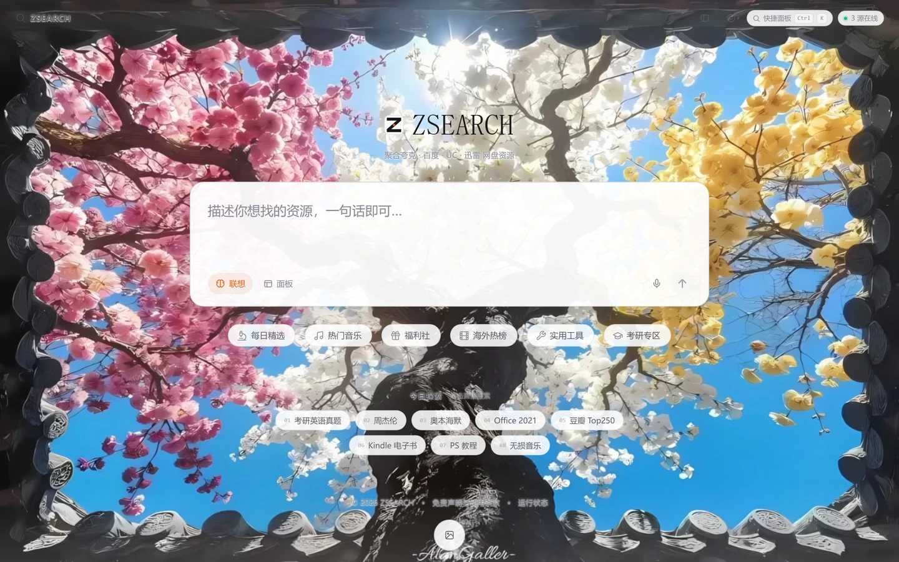
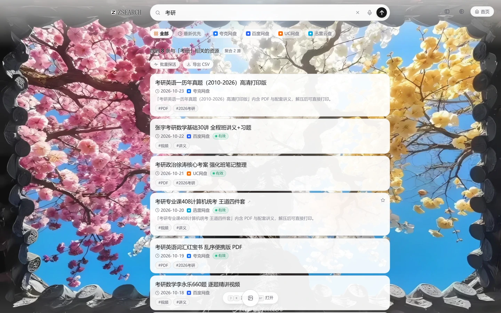

# ZSEARCH 界面优化：白色条带 · 字体重影 · 背景清晰度 · 背景固定 · 鼠标动效 · 运行性能

日期：2026-10-23　范围：`public/static/css/wallpaper.css`、`public/static/js/wallpaper.js`、`public/static/css/polish.css`
总改动：5 个文件，+401 / −149 行（其中 `index.html` / `search.html` 的改动只是 `_stamp.js` 刷新的资源哈希，各 2~3 行）。

优化后（1440×900，2x 像素密度，壁纸 w07「檐外花枝」）：

| 首页 | 结果页 |
| --- | --- |
|  |  |

出图脚本：`_shot_after.js`（首页）、`_shot_after_stub.js`（结果页）。
结果页走**离线打桩**（CDP 的 `Fetch` 域替换 `/api/search` 响应），因为出图当时上游被限流，
用的仍是真实 CSS 与真实渲染逻辑，验证的是版式不是数据。

---

## 一、先定位再改：三处视觉问题的真实来源

改之前用无头 Edge 在 2x 像素密度下逐项取证，结论与直觉不完全一致，先列出来（含被排除的怀疑）：

| 现象 | 真实来源 | 被排除的怀疑 |
| --- | --- | --- |
| 背景上方白色条带 | 结果页顶栏 `.results-header::before` —— `top:0; bottom:0` + **92% 纸白** + `1px` 下边框，铺满 120px 高 | 壁纸层的 `--wp-veil` 顶部白纱（存在，但是渐变，不产生硬边） |
| 字体重影 | 压在壁纸上的裸文字带着 **12~14px 的白色光晕**（`0 0 14px rgba(255,255,255,.92)`），在亮花瓣上把字形轮廓向外撑开一圈 | 占位提示层与原生 placeholder 重叠（历史 bug，`has-ghost` 已修）；两层文字真的重叠（实测两两求交，0 处交叠） |
| 背景不清晰 | 四层减法没做：白雾 16% + 顶部白纱 34% + 纸白暗角 + 56px 网格 + 双层噪点 | 图片分辨率不足（1824×1218，1440 下是**降采样**，本来就够） |
| 背景不固定 | `initParallax` 让整张图随鼠标反向位移 ±12px，实测一次移动后 `transform` 变成 `matrix(1.012,0,0,1.012,-7.91,-8.23)` | —— |

补一条：`1.012` 的保险放大本身也要背一部分"发软"的锅 —— 全屏图放大 1.2% 等于多插值一遍。它存在的唯一理由是盖住 12px 位移的露边。

---

## 二、逐项改动

### 1. 去掉背景上方的白色条带

**位置**：`public/static/css/wallpaper.css` :471 / :490（`html[data-wall="on"] .results-header` 与其 `::before`）

**改法**

- 底色从 `92% 纸白` 降到 **52%**，并且**从"填满"改成"向下淡出的渐变"**：`0% → 52%`、`68% → 14%`、`100% → 透明`。
- band 高度从"等于顶栏"改成 **顶栏 + 30px**（`bottom: -30px`），再用
  `mask-image: linear-gradient(to bottom, #000 0%, #000 78%, transparent 100%)` 让最后 22% 渐隐。
- 删掉 `border-bottom: 1px solid`。

**为什么这样改**：当初把颜色画在撑满 `100vw` 的 `::before` 上是对的（否则 `max-width:862px` 的 header 会在页面正中浮出一个硬边矩形）。错的是它的形状 —— "填满 + 描边"必然产生两条硬边。现在下沿没有任何边界，白带子"化"进壁纸里。

**预期效果**：顶栏区域内不再出现一条横贯全屏的白色矩形；壁纸从页面最顶端就开始，视觉上内容直接浮在照片上。品牌标的纸底仍有 52%→66% 的顶部托底，不至于丢形。

**连带修复（必须做，否则是回归）**：顶栏底色撤掉后，`.cloud-tab`（来源筛选胶囊）原本是 `background: transparent` —— 灰字直接压在照片上读不出来。已在 `wallpaper.css` :532–547 补 58% 雾面底，并**显式重写 `.active` / `:hover`**（这里选择器特异度是 `(0,2,1)`，高于原 `.cloud-tab.active` 的 `(0,2,0)`，不补会把高亮吃掉）。同一处还在 `.results-header` 上加了 3px 紧贴描边，靠 `text-shadow` 的可继承性一次覆盖顶栏内所有裸文字。

**第二处连带**：统计行 `.results-stats` 也是直接压在照片上的（y≈136，本来就在原白带之外）。描边只能把字"拔"出来，救不了它 14px / 55% 灰的体量 —— 压在亮花瓣上整行像一层浮灰。`wallpaper.css` :575–600 补了两条：正文提到 `--text-strong`；行内 `.src-tag` 给 72% 雾面底（它本来就是个胶囊，补底不算新增方块），并显式覆盖 `.warn` 的黄色底（`rgba(251,191,36,.1)` 压在照片上等于没有）。

---

### 2. 消除字体重影

**位置**：`wallpaper.css` :405（首页四件：`.home-logo-sub` / `.explore-head` / `.site-footer` / `.home-header-brand`）、:558（结果页三件：`.results-stats` / `.wb-tools` / `.searching-hint`）

**改法**（亮调；暗调同样收紧）

```diff
  text-shadow:
-   0 0 14px rgba(255, 255, 255, 0.92),
-   0 1px 2px rgba(255, 255, 255, 0.75);
+   0 0 3px rgba(255, 255, 255, 0.94),
+   0 1px 1px rgba(255, 255, 255, 0.62);
```

**为什么这样改**：光晕越宽越像**影子**，越窄越像**描边**。14px 的白晕在亮花瓣上把字形撑成一团白毛，读起来就是"两行字错开叠着"。收到 3px 之后它退化成一条贴边的白线：在深色树干上照样保住对比度，但不会长出第二层轮廓。这层机制原本的目的（浅色壁纸暗部吃掉灰字）完全保留。

**预期效果**：`.home-logo-sub`、页脚、来源筛选胶囊、统计行、中间态提示全部变清晰，不再有"糊/双影"的观感；不用给任何文字加白底块。

---

### 3. 提升背景清晰度

四处**减法**，全部在 `wallpaper.css`：

| # | 位置 | 改动 | 效果 |
| --- | --- | --- | --- |
| ① | :89 `--wp-scrim` | 亮调 `0.16 → 0.05`；暗调 :131 `0.42 → 0.26` | 去掉了整屏 11% 白（暗调 16% 黑）的常驻雾 |
| ② | :90 `--wp-veil` | 亮调顶部 `0.34 → 0.10`、长度 `26% → 15%`、底部 `0.40 → 0.16` | 顶部不再有一条牛奶带；页脚压边保留但更淡 |
| ③ | :336 `[data-wall="on"] .atmosphere .grid` | `display: none` | 56px 网格压在照片上就是一层摩尔纹，眼睛会把它读成"糊" |
| ④ | :344 `.atmosphere .vignette` | 开壁纸时换成中性暗角（`rgba(10,10,14,.12)`，从 70% 才起）：原来是拿 `var(--bg)` 纸白在 128% 处收边，等于四边发白的雾边 | 四角从"发白"变成"微收"，视线更聚 |
| ⑤ | :357 `.atmosphere .grain` | 开壁纸时 `display: none` | 原来 `.wall-grain`(0.05) 和它(0.022/0.038) 两层叠着，浓度接近 0.09，照片明显"发沙"；现在只留跟随壁纸淡入的那一层 |
| ⑥ | :201 `.wall-layer { transform }` | `scale(1.012)` → `none` | 全屏图不再被放大重采样，少一遍插值 |
| ⑦ | :325 `.atmosphere .aura` | `0.55 → 0.28` | 三块彩色极光叠在照片上是一层"说不清的彩雾" |

**预期效果**：底色更"透"，照片的暗部细节和色相回来，整体从"蒙着一层奶"变成"隔着干净玻璃"。同理反过来说，这一步做完之后**文字的对比度是下降的** —— 这就是第 2 项必须同时收紧光晕、第 1 项必须给筛选胶囊补底的原因。三件事是一组。

---

### 4. 把背景固定住

**位置**：`public/static/js/wallpaper.js` :223 `syncLayerScale()`（取代原 `initParallax()` 的位移逻辑）、`wallpaper.css` :201

**改法**

- 删除整段"指针驱动整图位移"的 rAF 循环（原 `initParallax`，约 100 行）。
- 壁纸层 `transform` 默认 CSS 就是 `none`，JS 不再每帧写它。
- 只保留 blur 的 overscan：模糊 > 0 时补一个 `scale(1.06)` 防露边。**这个 scale 只在模糊值变化时写一次**，不跟帧。
- 变量从 `parallaxSync` 改名为 `layerSync`，因为它的职责只剩"同步缩放"。

**验证**：鼠标从 `(300,300)` 移到 `(1080,640)`，壁纸层 `transform` 全程是 `none`（改前是 `matrix(1.012,0,0,1.012,-7.91,-8.23)`）。

**预期效果**：长列表滚动时余光不再被背景牵动；静止时画面完全静止，是"照片"，不是"会晃的壁纸"。

---

### 5. 有智能感的鼠标交互动效

**位置**：`wallpaper.css` :272–320（`.wall-light` 及其 `.is-live`、暗调、`prefers-reduced-motion` / `pointer: coarse` 关断）；`wallpaper.js` :248 `initPointerLight()`；`wallpaper.js` :561 `ensureLight()`（挂进 `.wall-stage`）

**设计**：把原来的"整张图位移"换成一层 **900×900 的柔光斑跟着指针走**。

- 圆心是 `radial-gradient`：外层 10% 白提亮画面，中心 34% 处一圈 **5% 品牌橙**（`--accent` #E16C28），让这团光带温度，不像手电筒。暗调降为 6% 白 / 4% 橙。
- 缓动跟随（`EASE = 0.14`，比原视差略快，因为"光要跟手"）；收敛到 0.5px 内**立即停 rAF**。
- 指针第一次移动时**直接落位再淡入**——否则光会从 `(0,0)` 一路"飞"进指针处。
- `pointerleave` 只淡出、不归位：归位会让光当着用户的面飞向角落，比不归位更刻意。
- 触屏（`pointer: coarse`）与 `prefers-reduced-motion` 下 `display: none`（触屏没有悬停，光会停在最后点到的位置，像一块污渍）。
- 只在 `[data-wall="on"]` 时工作：没有壁纸时底色是纯纸面，白光压在白底上看不见。
- 关掉壁纸时立刻撤 `.is-live`，光熄灭。

**顺带修掉一个真 bug**（`polish.css` :112，结果卡聚光）：`prefers-reduced-motion` 块原来把 `::before` 和 `.pending-in.in-view` 写在同一个选择器组里，一起给了 `opacity: 1` —— 系统开了"减少动态效果"的用户那边，**每一张**结果卡都常亮聚光，"只有被指向的那一张亮"直接失效，整页铺满橙色光斑。现已拆成两条：光斑只去 `transition`，`opacity` 交回 `.is-spot` 控制。

**预期效果**：移动鼠标时能感到画面"活着"，但图本身不动 —— 接近"相机不动、光在动"的观感。静止时零开销。结果卡聚光在关动效的用户那边也恢复正确语义。

---

### 6. 运行性能

| 项 | 改动前 | 改动后 |
| --- | --- | --- |
| 全屏层 `transform` 写入 | 每帧最多 2 次（两层壁纸层，30fps 节流） | **0 次**（只在模糊变化时写一次 scale） |
| 全屏图重采样 | `scale(1.012)` 常驻，每帧一次插值 | 无（`transform: none`） |
| 全屏网格层 | 常驻绘制（56px 重复渐变 + radial mask） | 开壁纸时 `display: none` |
| 全屏噪点层 | 2 层叠加（≈0.09 浓度） | 1 层（0.05） |
| 全屏彩色极光 | 3 个 `width:96vw` 层的无限 `transform` 动画，整体 0.55 不透明度 | 保留动画（走合成器，实测不贵），不透明度降到 0.28 |
| 鼠标跟随开销 | 2 个全屏层的合成面积 | 1 个 900×900 层的合成面积（≈1/6 屏） |
| 指针停下后 | rAF 收敛即停 | 同（新增，从第一版就守住） |

**没有做的事（避免"为了省而省"）**：没有删 `.aura` 的三个 `transform` 动画 —— 实测它走合成器，开与不开帧时间无差异（历史数据 223fps vs 225fps），贵的是早年那层 `blur(72px)`。没有给光斑挂常驻 `will-change` —— 历史教训：两张全屏层常驻 `will-change` 约 10MB 且不再回收；光斑靠 `translate3d` 自己就会提层。

---

## 三、验证

| 项 | 方式 | 结果 |
| --- | --- | --- |
| 顶栏白带 | 2x 截图看下沿 | 硬边消失，壁纸从顶端开始 |
| 字体重影 | 原生 2x 像素裁切看字形 | 单层、干净；14px 光晕已不存在 |
| 两层文字真的重叠？ | 遍历页面上部所有载文元素，两两求交（排除父子） | 0 处交叠（t=1.2/1.9/2.8/5/9s 五次采样） |
| 背景固定 | 移动鼠标前后读壁纸层 `transform` | `none → none`，PASS |
| 光斑跟随 | 同上，读 `.wall-light` | `opacity 0 → 1`，`translate3d(1079.5, 639.8)`（目标 1080,640） |
| 光斑可见度 | 同帧差图 | 光心像素 `(71,95,100) → (89,111,115)`，最大通道差 22/255；全图平均差 0.99 —— 克制但不是没有 |
| 关壁纸 | `set(null)` 后移动鼠标 | `.wall-light` opacity 归 0，PASS |
| 静态审查 | `node _qa_ui_static.js` | 55 / 55 通过（含"无使用但未定义的 CSS 变量"47 个） |
| 界面回归 | `node _qa_ui.js` | 30 / 38；8 项失败全部是"结果 0 条"的下游项 |
| 上述 8 项专项复核 | `node _verify_results_stub.js` | **12 / 12 通过**（打桩数据，真实渲染与键盘逻辑） |

> **关于那 8 项失败**：不是本次改动造成的。同时段上游三个源全部不可用（`pansou` timeout / 被限流 400、`hunhepan` 429 退避升到 120s、`zreso` 冷却 600s、`upstream` 熔断 300s），而 `aggCache` 的空结果是 **3 分钟 TTL**，期间所有请求都命中空缓存。改前的基线是 38/38。
>
> 为了不让这 8 项处于"没验过"的状态，另写了 `_verify_results_stub.js`：用 CDP 的 `Fetch` 域把 `/api/search` 换成固定假数据，页面跑的仍是**真实的 `results.js` 渲染与 j/k 键盘导航**，逐条复刻了 `_qa_ui.js` 第 5/6 节的断言 —— 12/12 通过。等上游恢复后仍建议用真实数据复跑一次 `_qa_ui.js`，确认回到 38/38。
>
> 建桩时的两个坑（第一版桩造出过假失败）：`first_url` 必须是**站内短链 `/go/…`**（`results.js` 直接把它当 href），来源徽章读的是 `_providers` 而不是 `provider`。

---

## 四、留给下一轮的事

1. **上游恢复后复跑 `_qa_ui.js`**，确认回到 38/38（当前 30/38 + 打桩专项 12/12）。
2. **`docs/交互体验升级方案-2026-10-23.md` 的 P0 批次**尚未实施（时长/位移/字号令牌统一、暗色 accent 归一等）。本轮只做视觉与性能，没有动令牌体系。
3. 首页副标题（`.home-logo-sub`「聚合夸克 · 百度 · UC · 迅雷」）压在白色花瓣上时只有约 3:1 对比度。它是有意做成三级信息的，本轮没有再压暗（再暗会和 ZSEARCH 字标抢注意力）；如果希望更实，建议提一档到 `var(--text)`，而不是加光晕。
